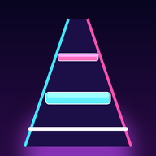

<div align="center">



# Table Drummer

**The rhythm game you play by hitting a table.**<br>
Grab two drumsticks (or just clap). Your microphone is the controller.

<br>

<a href="https://tabledrummer.netlify.app/"></a>

<br><br>


<br><br>


</div>

<br>

## ▶ Play in 10 seconds

1. Open **[tabledrummer.netlify.app](https://tabledrummer.netlify.app/)** in Chrome, Edge or Safari, on a phone or a PC.
2. Allow the **microphone** when asked.
3. Go to **Setup**, then tap **Auto-tune** and **Calibrate**. That takes about a minute, once.
4. Pick a song and hit the table when each block lands on the line.

> 🎧 **Use headphones.** Through speakers, the mic hears the music and plays by itself.<br>
> 📱 **Install it like an app:** in your browser menu, choose **Add to Home screen**. It works offline after the first visit.<br>
> 🙌 **No sticks?** Clap, tap the screen, or press <kbd>Space</kbd>.

<br>

## ✨ What's inside

<table>
<tr>
<td width="50%" valign="top">

### 🥁 One input, real rhythms
Every hit counts the same: sticks, claps or taps. The mic picks up each hit and judges it **Perfect**, **Good** or **OK** down to the millisecond.

### 🎵 20 original songs
Pop-punk, post-hardcore, J-rock, Afrobeat, amapiano, ska, dembow, surf rock and more, all **synthesized live** in the game. 10 are free, and 10 unlock with coins you earn by playing.

### ⬆ Play your own music
Upload an **MP3, WAV or FLAC**. The game separates the drums, follows the beat (even when a live band drifts) and builds a one-button chart from the kick, snare, hi-hats and melody. You get **Easy, Normal and Hard**, or you can record your own chart.

</td>
<td width="50%" valign="top">

### 📖 Learn music
**29 lessons** with real drum notation that scrolls as you play: quarter notes to 16ths, triplets, swing, syncopation, clave, Afrobeats 3-3-2 and breakdowns. Earn up to ★★★ per lesson, or use **Free practice** to train your timing.

### 🔥 Style and high scores
Climb the style ranks from **D to SSS** while you play. There's a high score table with your player name, combos, 6 hearts per song, and coin-powered continues.

### 🎨 Make it yours
Neon, Sunset and Aurora color schemes, dark and light mode, and a hit sound of your choice (kick, snare, clap or tap). A sync code moves your progress to another device.

</td>
</tr>
</table>

<br>

<div align="center">


</div>

<br>

## 📦 Download

| Platform | How to get it |
|---|---|
| 🌐 **Any browser** | Play at **[tabledrummer.netlify.app](https://tabledrummer.netlify.app/)** |
| 🤖 **Android** | `TableDrummer.apk` from **[Releases](../../releases)**. Allow *Install unknown apps* when asked. |
| 🪟 **Windows** | `Table Drummer Setup.exe` (installer) or the portable `.exe` from **[Releases](../../releases)**. If Windows warns you, click *More info → Run anyway*. |

The apps are built automatically by GitHub Actions: open the **Actions** tab, then **Build apps** → **Run workflow**.

<br>

## 🛠 Build it yourself

<details>
<summary><b>Project structure</b></summary>

```
table-drummer/
├─ www/                     the whole game (a single index.html) + icons, manifest, offline support
├─ electron/main.js         Windows / macOS / Linux desktop app
├─ scripts/                 adds the microphone permission to the Android app
├─ capacitor.config.json    Android app settings
├─ package.json             build scripts
└─ .github/workflows/       automatic app builds and website publishing
```
</details>

<details>
<summary><b>Android app (Android Studio)</b></summary>

Requires Node.js 20+ and Android Studio.

```bash
npm install
npm run android:add      # creates the Android project and adds the mic permission
npm run android:open     # opens it in Android Studio → ▶ Run, or Build → Generate Signed Bundle
```
</details>

<details>
<summary><b>Windows / macOS / Linux app (Electron)</b></summary>

Requires Node.js 20+.

```bash
npm install
npm run pc               # run as a desktop app
npm run build:win        # dist/Table Drummer Setup 1.4.0.exe + a portable .exe
```
</details>

<details>
<summary><b>Host the website yourself</b></summary>

Upload the contents of `www/` to any static host with **https** (Netlify, GitHub Pages, Cloudflare Pages). The microphone only works on https pages.
</details>

<br>

## 💡 Tips

- **Notes feel late or early?** Run **Setup → Calibrate timing** again. Bluetooth headphones add delay, and calibration fixes it.
- **Taps not heard?** Run **Auto-tune**, move the phone or mic closer to where you hit, or turn sensitivity up.
- **Hard song?** Lower the **note speed** in Setup, or practise the rhythm in **Learn music** first.
- **New phone?** Setup → **Copy sync code** on the old device, then **Enter sync code** on the new one.

<br>

<div align="center">

---

**Created by [Shakir](https://github.com/shakirPYJV)** · Built with Web Audio and Canvas · All music is original

<a href="https://tabledrummer.netlify.app/"><b>▶ Play Table Drummer</b></a>

</div>
